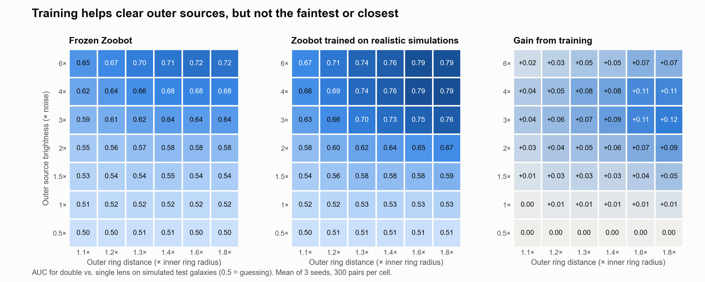
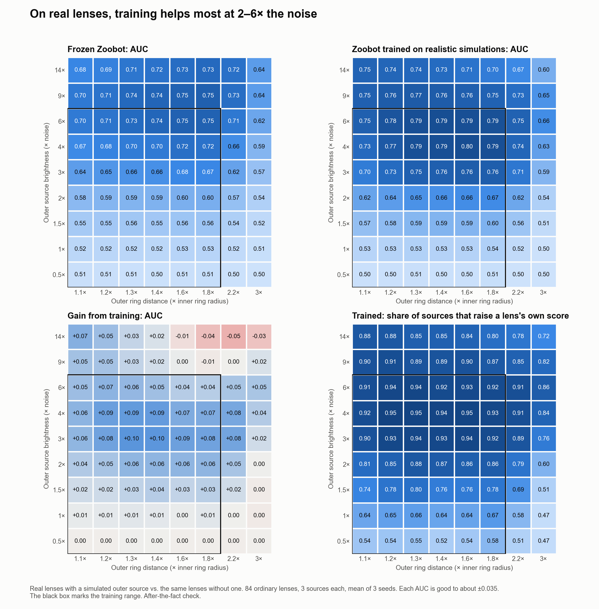
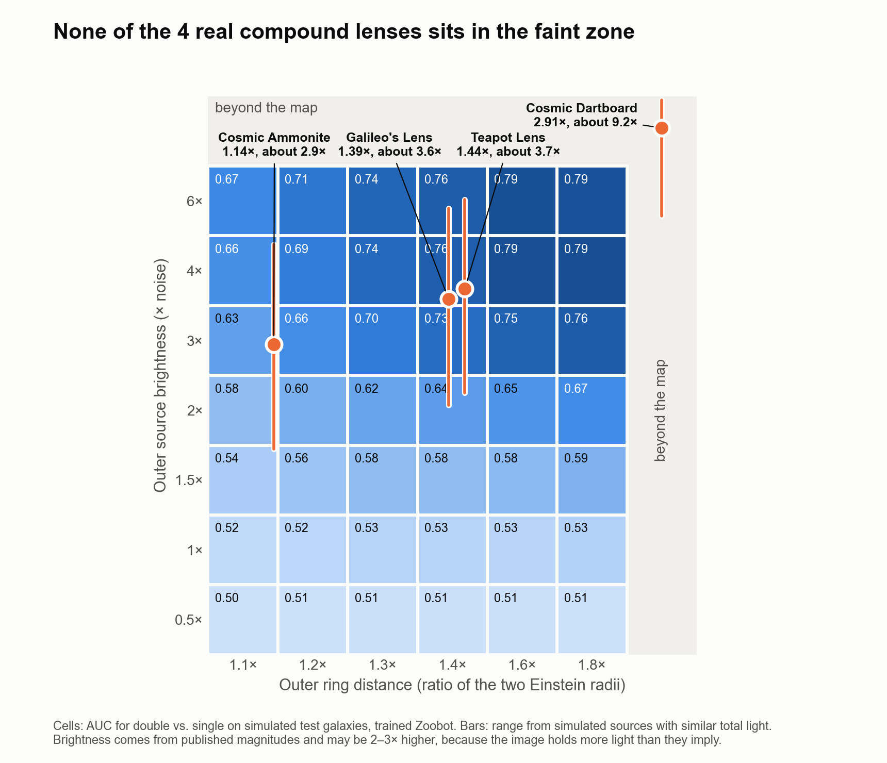

# Ruby: compound lens results

Last updated Nov 2, 2026. Every number here comes from the saved outputs listed under [Files](#files). "Per seed" always means seeds 1, 2, 3, in that order.

## Bottom line

- **No model passed all 5 pass marks.** The 3-answer Zoobot passed 2. By the rule we set before training, the result to report is the detection map and the gap between simulated and real lenses.
- **Strongest result:** trained on realistic simulations, the 3-answer Zoobot ranked the 4 real compound lenses 3.9 of 79 on average. Guessing gives 40, the pass mark was 23, and painted-ring training gave 28 to 56.
- **Faint limit:** on real lenses, the model stops reliably noticing an added outer source at about 1.5–2× the noise. Training helps at 2–6× and does nothing at 1× or below.
- **Close limit:** the outer position still counts for clearly more than the same extra light down to about 1.2× (frozen Zoobot about 1.3×). That number depends on the cutoff, and it doesn't show the model can separate close rings.
- **Lens finding:** used alone, the model costs about 0.01 AUC of ordinary lens finding. Using the baseline to find lenses and this model only to check them avoids that cost.
- **False alarms:** on 5,000 new non-lenses, that two-step setup flags 0.4–1.4% depending on the seed. By the rule set beforehand, it stays a second step on lenses already found.

## Goal and baseline

- **Baseline:** Zoobot fine-tuned on real lenses. Test AUC per seed: 0.9930, 0.9917, 0.9851.
- **Goal:** map how faint and how close a second ring can be before a lens finder stops recognizing it, and show that training on simulated compound lenses expands that limit without hurting ordinary lens finding.
- **Where that stands:** the map exists, and training expands the limit for clear outer sources but not faint ones. Used alone, it does hurt ordinary lens finding slightly.

## Data and models

**Real data:** 100×100 cutouts at 0.1″ per pixel.

| Split | Non-lenses | Lenses |
|---|---|---|
| Train | 1,395 | 346 |
| Validation | 299 | 74 |
| Test | 300 | 79 (75 ordinary, 4 compound) |

**The 4 compound lenses:** Cosmic Dartboard, Galileo's Lens, Cosmic Ammonite and Teapot Lens. All are grade A. They are convincingly modelled candidates, not spectroscopically confirmed.

**Simulations (`sim/out/v2`, full details in [SIMULATION.md](SIMULATION.md)):** 3,000 / 600 / 600 pairs of single and double, using two source distances, Euclid's published lens models, the measured blur of about 0.2″, real host galaxies and lumpy sources.

- Distance `d` is the outer ring's radius divided by the inner ring's, from 1.1× to 1.8×.
- Brightness `b` is the bright part of the outer source in noise units, from 0.5× to 6×.

| Model | What it is |
|---|---|
| Baseline | Zoobot fine-tuned on real lenses, with no compound answer |
| Frozen | Baseline encoder, untouched, plus a simple double-vs-single classifier. This is the "before" for the map |
| zoobot3 | Baseline with a new 3-answer output (not a lens / lens / compound), retrained end to end |
| polar3 | The polar branch with the same 3 answers, trained from scratch |

**Training labels:** not a lens = real non-lenses; lens = real lenses + simulated singles; compound = simulated doubles. Simulated singles count as "lens", so looking simulated can't mean compound.

**Scored models:** round 2, in `sim/out/models2`. Round 2 was one allowed extra round after round 1's validation results. It used longer patience and removed doubles with signal under 6 from training (2,011 of 3,000 kept). Both changes were made together, so their effects can't be separated.

## Final test: the verdict

One look at the test set. Pass marks were fixed in the `train_models.py` header before training.

| Mark | Needed, every seed unless noted | zoobot3 per seed | Result | polar3 per seed | Result |
|---|---|---|---|---|---|
| Real compound lenses, mean rank of 79 | Average 23 or better, under 40 | 3.8, 4.5, 3.5 (average 3.9) | **PASS** | 11.0, 9.5, 13.5 (average 11.3) | PASS |
| Ordinary lenses called compound | At most 20% | 11%, 7%, 7% | **PASS** | 23%, 1%, 3% | FAIL |
| Lens finding vs. same seed's baseline | Within 0.01 | −0.0106, −0.0159, −0.0067 | FAIL | −0.0317, −0.0296, −0.0288 | FAIL |
| Map cells of 42 at AUC 0.8 | At least 5 more than frozen | 0, 0, 2 vs. 0, 0, 0 | FAIL | 0, 0, 0 | FAIL |
| Real lens + simulated outer source, vs. frozen | Ahead by at least 0.05 | +0.069, +0.063, +0.014 | FAIL | +0.023, +0.011, −0.004 | FAIL |

**Rank of each compound lens, per seed:**

| Lens | zoobot3 | polar3 | Frozen |
|---|---|---|---|
| Cosmic Dartboard | 1, 1, 1 | 5, 2, 31 | 15, 6, 7 |
| Galileo's Lens | 6, 2, 4 | 26, 4, 3 | 1, 2, 2 |
| Cosmic Ammonite | 3, 8, 3 | 12, 12, 16 | 3, 27, 9 |
| Teapot Lens | 5, 7, 6 | 1, 20, 4 | 8, 13, 22 |
| **Mean** | **3.8, 4.5, 3.5** | 11.0, 9.5, 13.5 | 6.8, 12.0, 10.0 |

**How to read this:**

- The result is strong but rests on 4 lenses. They were also already known and scored by earlier models, so this wasn't their first look.
- Frozen also ranks them well on the same simulations (average 9.6). Fitted on painted faint rings, it got 23, 37, 36. So the realistic training data does much of the work, and frozen alone would have met the rank mark.
- All 4 score above 0.5 on every seed, against 5–8 of 75 ordinary lenses.
- Chance of 4 random lenses averaging 3.9 or better: 18 in 1,502,501.

## Detection map

### On simulated galaxies

zoobot3 AUC, double vs. single, mean of 3 seeds. 300 pairs per cell.

| Brightness | 1.1× | 1.2× | 1.3× | 1.4× | 1.6× | 1.8× |
|---|---|---|---|---|---|---|
| 6× | 0.671 | 0.707 | 0.742 | 0.760 | 0.789 | 0.786 |
| 4× | 0.660 | 0.694 | 0.735 | 0.759 | 0.792 | 0.794 |
| 3× | 0.632 | 0.663 | 0.697 | 0.727 | 0.752 | 0.763 |
| 2× | 0.577 | 0.602 | 0.622 | 0.636 | 0.651 | 0.667 |
| 1.5× | 0.544 | 0.561 | 0.576 | 0.576 | 0.581 | 0.595 |
| 1× | 0.517 | 0.524 | 0.529 | 0.530 | 0.527 | 0.533 |
| 0.5× | 0.504 | 0.505 | 0.506 | 0.507 | 0.506 | 0.505 |

Gain from training (zoobot3 minus frozen):

| Brightness | 1.1× | 1.2× | 1.3× | 1.4× | 1.6× | 1.8× |
|---|---|---|---|---|---|---|
| 6× | +0.021 | +0.034 | +0.047 | +0.051 | +0.069 | +0.069 |
| 4× | +0.041 | +0.054 | +0.075 | +0.083 | +0.111 | +0.114 |
| 3× | +0.045 | +0.058 | +0.074 | +0.089 | +0.115 | +0.123 |
| 2× | +0.028 | +0.044 | +0.052 | +0.058 | +0.073 | +0.088 |
| 1.5× | +0.015 | +0.026 | +0.032 | +0.029 | +0.038 | +0.050 |
| 1× | +0.003 | +0.007 | +0.009 | +0.009 | +0.009 | +0.014 |
| 0.5× | −0.001 | 0.000 | 0.000 | +0.001 | +0.001 | +0.001 |

- 17 of 42 cells gain at least 0.05. The biggest gain is +0.123 at 3× and 1.8×.
- The best cell is 0.794, so no cell reaches 0.8 on the mean of the seeds.
- Counted after the fact, cells at AUC 0.7 are 12, 13, 14 vs. frozen 3, 2, 4. That was not a pass mark.

### On real lenses

84 ordinary validation and test lenses, each compared with itself plus a simulated outer source. Each cell is good to about ±0.035. Means over distances 1.1× to 1.8×:

| Brightness | zoobot3 AUC | Frozen AUC | Gain | Source raises its own lens's score |
|---|---|---|---|---|
| 14× (beyond training) | 0.73 | 0.71 | +0.02 | 85% |
| 9× (beyond training) | 0.76 | 0.73 | +0.02 | 89% |
| 6× | 0.78 | 0.73 | +0.05 | 93% |
| 4× | 0.78 | 0.70 | +0.08 | 94% |
| 3× | 0.74 | 0.66 | +0.09 | 93% |
| 2× | 0.65 | 0.59 | +0.06 | 85% |
| 1.5× | 0.59 | 0.56 | +0.03 | 77% |
| 1× | 0.53 | 0.52 | +0.01 | 65% |
| 0.5× | 0.51 | 0.51 | 0.00 | 55% |

- **Faint limit:** noticing fades at about 1.5–2× the noise.
- **Why AUC tops out near 0.80:** lenses differ a lot from each other, so one image is often hard to judge even when the outer source clearly raises that lens's own score.
- **Close limit:** the response barely drops down to 1.1×, but that isn't proof of separating close rings. Extra light at the inner ring's radius also raises the score, and at the median 0.84″ radius the 1.1× and 1.2× gaps (0.08″, 0.17″) are smaller than the 0.2″ blur.

## The gap between simulated and real

**1. A model can still tell our simulations from real lenses.** Real vs. simulated single, retrained Zoobot: 0.909, 0.904, 0.900. The mark was below 0.90 on every seed, and it was missed after the 2 allowed fix rounds. This is still far better than painted rings (0.996). The ring zone is the main cue: 0.864 with only that zone visible, 0.703 with it hidden.

**2. The same model scores simulated and real images very differently.** Mean P(compound), zoobot3, per seed:

| Images | Seed 1 | Seed 2 | Seed 3 |
|---|---|---|---|
| Ordinary real lens | 0.21 | 0.16 | 0.12 |
| Real lens + simulated outer source | 0.36 | 0.34 | 0.27 |
| Simulated single | 0.46 | 0.40 | 0.32 |
| Simulated double | 0.54 | 0.53 | 0.47 |
| Real compound lens | 0.79 | 0.75 | 0.87 |

**3. The simulated map is a little harsher than the real-lens map.** Across the 24 cells at brightness 2+, the real-lens map averages 0.739 and the simulated map 0.703 (+0.036). The rule set beforehand reads this as "in between". The difference is mostly at 1.1–1.3×.

**4. Real compound lenses do much better than the map predicts, and we don't know why.** On every seed they beat 95–100% of ordinary lenses, where their nearest map cells predict 0.65–0.79.

| Lens | Distance | Brightness (range) | Nearest real-lens cell | Mean rank |
|---|---|---|---|---|
| Cosmic Dartboard | 2.91× | 9.2× (5.5–15.2) | 0.65 | 1.0 |
| Galileo's Lens | 1.39× | 3.6× (2.1–5.8) | 0.79 | 4.0 |
| Cosmic Ammonite | 1.14× | 2.9× (1.7–4.7) | 0.70 | 4.7 |
| Teapot Lens | 1.44× | 3.7× (2.2–6.0) | 0.79 | 6.0 |

- None of the 4 is in the faint zone, so the faint limit is untested on real compound lenses.
- Dartboard is off the map on both axes and outside the training range.
- Radii and magnitudes come from Li et al. 2026, Table 2. The table doesn't say outright which radius is the inner one, so that is inferred.
- The zero point is uncertain: light within 3″ is 2.0–3.1× what the published magnitudes imply, so true brightness may be 2–3× higher.

## Follow-up tests

All of these ran after the final test, so none can change the verdict.

| Test | Rule set beforehand? | Result |
|---|---|---|
| Basic checks | No | No file or brightness shortcut found |
| Second-ring test, part 1 | Yes | Mixed |
| Second-ring test, part 2 | Yes | Outer ring, 3 of 4 lenses |
| Candidate sheet | No | Known compound lenses rank 1, 2, 3, 8; top 20 others unconfirmed |
| Two-step test | Yes | Worth using, all 3 seeds |
| Real lenses placed on the map | No | None in the faint zone |
| Real-lens map | Yes | In between |
| Ring transplant test | Yes | The test doesn't work |
| Bigger test on new images | Yes | Stays a second step |
| Close-ring test | Yes | Close limit 1.2×, frozen 1.3×; the gap reading doesn't work as a test |

### Basic checks

- The 4 lenses come from the same folder, with the same shape and noise as the other lenses.
- Simple brightness and size measures rank them 22–62 on average and explain 16% of the score on ordinary lenses. With those removed, the ranks stay 1, 2, 6, 3.
- The baseline's own lens score ranks them 24.5 on average, for reference. It has no compound answer.
- Keeping light only out to 1″ gives compound 0.28 vs. ordinary 0.20. Out to 2″ gives 0.81 vs. 0.34. So the difference comes from light at 1–2″.

### Second-ring test

**Part 1: the same total light added to 43 real validation lenses, brightness 2+.** Mean rise in score:

| Where the light goes | Seed 1 | Seed 2 | Seed 3 |
|---|---|---|---|
| Outer ring position | +0.218 | +0.274 | +0.286 |
| Inner ring's radius | +0.116 | +0.124 | +0.117 |
| Small blob | +0.058 | +0.035 | +0.024 |

The verdict is "mixed", because outer needed 2× same-radius on every seed and seed 1 got 1.88×. Clutter barely matters, but light at the inner radius still counts for about half.

**Part 2: hiding zones on the 4 real compound lenses.** Mean score over seeds:

| Lens | Full | Outer hidden | Inner hidden | Control hidden |
|---|---|---|---|---|
| Cosmic Dartboard | 0.93 | 0.20 | 0.85 | 0.85 |
| Galileo's Lens | 0.80 | 0.30 | 0.40 | 0.74 |
| Cosmic Ammonite | 0.79 | 0.55 | 0.42 | 0.76 |
| Teapot Lens | 0.70 | 0.78 | 0.42 | 0.61 |

The zones were chosen knowing the lenses. Hiding the control zone also beats 93–95% of ordinary lenses, so the comparison with control carries the evidence, not the comparison with ordinary lenses.

### Two-step test

The baseline keeps images above a cutoff that keeps 95% of validation lenses, then zoobot3 flags P(compound) > 0.5.

| Per seed | zoobot3 alone | Two steps |
|---|---|---|
| Lens-finding AUC | 0.9824, 0.9758, 0.9785 | 0.9930, 0.9917, 0.9851 (the baseline's, by construction) |
| Compound lenses flagged, of 4 | 4, 4, 4 | 4, 4, 4 |
| Non-lenses flagged, of 300 | 16, 16, 11 | 6, 3, 2 |
| Ordinary lenses flagged, of 75 | 8, 5, 5 | 8, 4, 3 |
| Compound mean rank | 6.0, 10.0, 5.5 | 4.25, 5.0, 3.0 |

- Step one keeps 76, 75, 73 of the 79 lenses and drops no compound lens.
- This doesn't change the final-test verdict.
- It isn't a sky-wide search. This small sample flagged 1.2% of non-lenses, and the [bigger test](#bigger-test-on-new-images) puts the rate at 0.76%.
- The best fit is checking a catalog of already-found lenses, where about 7% would be flagged, roughly 33 of 497.

### Ring transplant test

The test lifted each real outer ring and added it to ordinary lenses, then compared that with simulated light and with light lifted from ordinary lenses as a control. By the rule set beforehand, **the test doesn't work**. Control light raised the score by more than a third of the ring's rise, because the same zone of an ordinary lens isn't empty. Lifted Ammonite and Teapot rings also include inner ring light (about 4× the published light).

Mean rises were ring +0.536, simulated +0.268, control +0.245, control scaled +0.313. Treat these as hints only. The control was not redesigned after seeing the result.

### Bigger test on new images

The same frozen models on 5,000 new non-lenses and 1,932 grade C candidates that no model had seen. The rules are in the `bigger_test.py` header, set before scoring. The target was lowered from 10,000 to 5,000 before any scoring, to save time.

| Per seed | Seed 1 | Seed 2 | Seed 3 |
|---|---|---|---|
| Baseline keeps at step one, of 5,000 | 293 | 214 | 240 |
| 3-answer alone flags | 273 | 205 | 129 |
| **Two steps flag** | **70 (1.40%)** | **24 (0.48%)** | **20 (0.40%)** |
| 95% interval | 1.11–1.77% | 0.32–0.71% | 0.26–0.62% |
| Baseline lens-finding AUC (old 300 non-lenses in brackets) | 0.9940 (0.9930) | 0.9927 (0.9917) | 0.9874 (0.9851) |
| 3-answer alone, lens-finding AUC | 0.9867 | 0.9791 | 0.9813 |

- **Reading set beforehand:** "stays a second step on lenses already found", because no seed got under 0.1%.
- **Compared with the small test:** the earlier 1.2% was a little high. The mean is now 0.76%, which is roughly 4,400 to 15,000 false alarms on 1.09M galaxies, depending on the seed. This assumes the sample is representative.
- **Baseline:** its 0.99 holds up against 5,000 new non-lenses. The 79 test lenses are the same ones as before, so only the non-lens side of this check is new.
- **Trust check:** the old test images gave the same scores as before, and all 4 compound lenses were flagged on every seed.

**Seed agreement, noticed after scoring, so a hint and not a result.** Images flagged on all 3 seeds:

| Images | Flagged on all 3 seeds |
|---|---|
| Known compound lenses | 4 of 4 |
| Ordinary test lenses | 1 of 75 |
| New non-lenses | 5 of 5,000 (0.1%, interval 0.04–0.23%) |
| Grade C candidates | 90 of 1,932 |

That would be roughly 1,100 false alarms on 1.09M galaxies. It doesn't change the reading, and it needs its own rule on new compound lenses before it counts.

**Grade C candidates (no right answers, so no pass or fail).** Compared with ordinary validation and test lenses:

| Per seed | Grade C | Ordinary lenses |
|---|---|---|
| Baseline keeps at step one | 88.0%, 81.1%, 80.2% | 95.3%, 94.6%, 93.3% |
| Two steps flag | 16.8%, 12.7%, 9.6% | 12.8%, 7.4%, 6.7% |

48 grade C candidates are kept on every seed and score at least 0.70, the lowest mean score of a known compound lens. That doesn't make them compound lenses. By eye, many of the top 20 show clutter, streaks or close neighbours, so they need an expert. A high score on a new non-lens could also be a real lens nobody has found: 2 of them score at least 0.70.

### Close-ring test

Each of 84 real lenses gets a simulated source at 1.1× to 1.8×, brightness 2–6× the noise, compared with the same total light placed two other ways: at the inner ring's radius, and spread into one thick band with no gap. The rules are in the `close_ring_test.py` header, set before scoring.

| Distance | Gap at median radius (0.87″) | Outer / same, 3-answer | Outer / same, frozen | Outer vs. thick AUC, 3-answer | Outer vs. thick AUC, frozen |
|---|---|---|---|---|---|
| 1.1× | 0.09″ | 1.37 | 1.21 | 0.55 | 0.54 |
| 1.2× | 0.17″ | 1.65 | 1.41 | 0.61 | 0.57 |
| 1.3× | 0.26″ | 1.90 | 1.56 | 0.65 | 0.60 |
| 1.4× | 0.35″ | 2.10 | 1.65 | 0.69 | 0.61 |
| 1.6× | 0.52″ | 2.24 | 1.80 | 0.71 | 0.63 |
| 1.8× | 0.69″ | 2.35 | 1.88 | 0.71 | 0.62 |

**Readings set beforehand:**

- **Close limit (outer at least 1.5× same on every seed):** 1.2× for the 3-answer Zoobot, 1.3× for frozen, so training expands it by one step. At the median radius, the gap at 1.2× is smaller than the 0.2″ blur, so this means the model responds to light farther out, not that it separates the rings.
- **Gap reading (outer beats thick on every seed):** 1.1× for both models, so training doesn't expand it.
- **Trust check:** passed, with a mean difference of 0.010 from the real-lens map.

**Why these readings need care, all noticed after scoring:**

- **The gap reading doesn't work as a test.** It passes at 1.1×, where the gap is well below the blur, and untouched frozen Zoobot passes too. The thick band spreads the light thinly, so it is fainter than a compact source. The test was not redesigned after seeing this.
- **There is no sharp limit.** The ratio rises smoothly, and the limit moves with the cutoff (3-answer, frozen): 1.25× gives 1.1, 1.2; 1.5× gives 1.2, 1.3; 1.75× gives 1.3, 1.8; 2× gives 1.6, none. The 3-answer Zoobot is ahead at every cutoff.
- **Training's edge isn't specific to close rings.** The outer source beats the same light 64–70% of the time for the 3-answer Zoobot and 59–65% for frozen, about 5 points ahead at every distance.
- **Lens size points away from seeing a gap.** The ratio is much higher on small lenses (median radius 0.73″: 1.62 at 1.1×, 4.74 at 1.8×) than on large ones (1.20″: 1.28 to 1.52), although large lenses have the wider gaps. Light at a small lens's inner radius may be getting lost in the galaxy's glare, but that wasn't tested.

## Why Polar-Zoobot failed

Polar-Zoobot unwraps the lens into a radius × angle strip, so a close gap isn't shrunk away and light around the ring can add up.

**Short version:** polar did see faint and close rings on painted images. It failed because Zoobot retrained on the same images saw them just as well or better, so polar added nothing. Its pass mark was to beat retrained Zoobot by 0.05 AUC.

| Painted-ring test, AUC | Polar | Retrained Zoobot | Frozen |
|---|---|---|---|
| Close rings, 1.2× / 1.3×, first build | 0.492 / 0.457 | 0.918 / 0.994 | 0.754 / 0.904 |
| Close rings, 1.2× / 1.3×, redesign | 0.909 / 0.970 | 0.918 / 0.994 | 0.754 / 0.904 |
| Faint rings, 1.4–1.8×, 0.5–2× noise | 0.937 alone, 0.940 joined with Zoobot | 0.942 | 0.870 |

- The first build saw only 0.175″ of radius at once and its head was tied to fixed radii. The redesign came after seeing seed 1.
- Joined minus retrained on faint rings was −0.001, −0.002, −0.002, and the mark was +0.05.
- So on painted rings, the blind spots looked like training gaps, not limits of the architecture.
- On realistic simulations, polar3 stayed below frozen on double vs. single (0.562, 0.565, 0.551 vs. 0.575, 0.573, 0.582).

Painted faint rings by brightness, mean AUC over 3 seeds:

| Brightness | Frozen | Polar alone | Retrained Zoobot | Averaged curve + simple classifier |
|---|---|---|---|---|
| 0.5× noise | 0.66 | 0.82 | 0.80 | 0.57 |
| 1× noise | 0.87 | 0.96 | 0.97 | 0.63 |
| 1.5× noise | 0.96 | 0.99 | 1.00 | 0.68 |
| 2× noise | 0.99 | 0.98 | 1.00 | 0.71 |

**Why the idea looked stronger than it was:**

- **The faint example was easy:** our illustration used a 2× noise ring, where frozen Zoobot already scored 0.99.
- **It showed one galaxy under ideal conditions:** a model has to judge each new galaxy with no "before" picture. The averaged curve alone reached only 0.71 at 2×, though a stronger classifier might do better.
- **The ring was perfect:** it was smooth and complete, while real outer sources are lumpy, broken arcs. Averaging around the full circle dilutes an arc, which may be why polar's edge disappeared on realistic simulations (polar alone about 0.56, frozen about 0.58, zoobot3 about 0.62). We didn't test that cause directly.

**What we never tested:** only polar alone ran on realistic images, and it was trained from scratch, while zoobot3 started from a model already trained on real lenses. The joined Polar-Zoobot never ran on realistic images, because it added nothing on painted rings (0.940 vs. 0.942). So polar's failure is clear on painted rings, but less fully tested on realistic ones.

**Painted-ring training didn't carry over to real lenses.** Mean rank of the 4 compound lenses, of 79:

| Model | Close-ring test | Faint-ring test |
|---|---|---|
| Retrained Zoobot | 28, 38 (seeds 2, 3) | 54, 46, 56 |
| Polar + Zoobot | Not built | 50, 48, 58 |
| Polar alone | 28, 27 first build; 66, 52 redesign | 19, 31, 22 |

Polar alone's 19, 31, 22 looks good but isn't selective: it called 58–76% of real lenses double. That led to the switch to realistic training data.

## What we can and can't claim

**We can say:**

- Training on realistic simulations puts the 4 real compound lenses near the top of 79 lenses, and every one is in the top 8 on every seed.
- Realistic data matters much more than a new architecture.
- On real lenses, training improves detection of an added outer source at 2–6× the noise, and not at 1× or below.
- Noticing fades at about 1.5–2× the noise.
- The model responds much more to light at an outer ring's position than to nearby clutter, and hiding the outer ring lowers the score on 3 of the 4 compound lenses.
- It works best as a second step on lenses that have already been found. Its two-step false-alarm rate on 5,000 new non-lenses is 0.4–1.4%.
- The baseline's 0.99 lens finding holds up against 5,000 new non-lenses.
- An outer source counts for clearly more than the same extra light down to about 1.2× for the 3-answer Zoobot and 1.3× for frozen. That is a working limit that depends on the cutoff, not a measured ability to separate rings.

**We can't say:**

- That it detects second rings specifically. Light at the inner radius also counts, and Teapot doesn't fit.
- Why real compound lenses do better than the map predicts.
- Where the faint limit sits on real compound lenses, because none of the 4 is faint.
- That it separates very close rings.
- That it works as a sky-wide search.
- That any new candidate is real. The top of the candidate sheet is unconfirmed, and some are clutter or streaks by eye.

**Main cautions:**

- There are only 4 real compound lenses, all grade A, found because they are obvious.
- The simulations missed the realism mark.
- The test look is used, so no more training or tuning against these 79 lenses. Re-scoring the saved models is fine.

## Reproducing the results

These are the commands that produced the saved outputs. They haven't been re-run end to end as one sequence. Run them from `~/ruby`, using `lens_env311/bin/python` as `python`.

They need these inputs:

- `data/split.csv`
- `data/cutouts/`, made by `get_negatives.py` and `make_cutouts.py` on the `vit-vs-zoobot` branch
- `q1_discovery_engine_lens_catalog.csv` and `data/zenodo_15003116/modeling_lens_mass.csv`, from [Zenodo](https://doi.org/10.5281/zenodo.15003116)
- the baseline models in `runs/zoobot_lr0.0001_seed{1,2,3}/best.pt`, made by `train.py` on the `vit-vs-zoobot` branch

Most scripts overwrite their output folder when re-run. Retrained models may not match the saved ones exactly, and any retraining needs new test data for a fair score.

| Result | Command |
|---|---|
| Polar, close rings | `python polar/quick_test.py --seed N` |
| Polar, redesign on seed 1 | `python polar/diagnose_polar.py` |
| Polar, faint rings | `python polar/faint_test.py --seed N` |
| Lens models | `python -I sim/prepare_lens_models.py data/zenodo_15003116/modeling_lens_mass.csv` |
| Blur | `python sim/measure_blur.py` |
| Host galaxy scores | `python sim/score_hosts.py` |
| Realism tuning | `python sim/tune_realism.py [sources\|brightness\|shapes]` |
| Simulations | `python sim/simulate.py --out sim/out/v2 --train 3000 --val 600 --test 600` |
| Simulation check | `python sim/check_sim.py` |
| Realism check | `python sim/realism_check.py --data sim/out/v2 --name v2` |
| Training, round 1 | `python -I sim/train_models.py --seed N` |
| Training, round 2 | `python -I sim/train_models.py --seed N --min-signal 6 --patience 8 --name models2` |
| Final test | `python -I sim/final_test.py` |
| Final map figure | `python -I sim/plot_final_map.py` |
| Basic checks | `python -I sim/final_checks.py` |
| Second-ring test | `python -I sim/second_ring_test.py` |
| Candidate sheet | `python -I sim/candidate_sheet.py` |
| Two-step test | `python -I sim/two_step.py` |
| Real lenses on the map | `python -I sim/place_real_lenses.py` |
| Real-lens map | `python -I sim/real_lens_map.py` |
| Real-lens map figure | `python -I sim/plot_real_map.py` |
| Ring transplant test | `python -I sim/transplant_test.py` |
| New Q1 images | `python -I sim/get_more_images.py` |
| Bigger test | `python -I sim/bigger_test.py` |
| Close-ring test | `python -I sim/close_ring_test.py` |

## Files

All paths are relative to `~/ruby`.

**In this branch:**

| Output | Folder |
|---|---|
| Final test: `results.txt`, `map.csv`, `ranks.csv`, `map.png` | `sim/out/final/` |
| Basic checks and second-ring test: `checks.txt`, `second_ring.txt`, figures | `sim/out/final/checks/` |
| Two-step test | `sim/out/final/two_step/` |
| Real lenses on the map | `sim/out/final/placement/` |
| Real-lens map | `sim/out/final/real_map/` |
| Ring transplant test | `sim/out/final/transplant/` |
| Bigger test: `results.txt` | `sim/out/expand/` |
| Close-ring test: `results.txt`, `cells.csv`, `rises.csv`, figures | `sim/out/final/close_ring/` |
| Realism check | `sim/out/realism/{v1,v2,v3}/` |
| Validation reports | `sim/out/models/`, `sim/out/models2/` |
| Polar tests: summaries, CSVs, figures | `polar/out/quick_test/`, `polar/out/faint_test/` |

**Left out of this branch:**

| Files | Why |
|---|---|
| Trained models (`*.pt`, `*.pkl`) | Too big for git |
| Simulated images, `sim/out/v1`, `v2`, `v3` | Too big. `sim/simulate.py` remakes them |
| Euclid cutouts, `data/cutouts/` and `data/expand/` | Too big. `make_cutouts.py` and `sim/get_more_images.py` download them again |
| Lens catalog and Zenodo lens models | Other people's data, available from [Zenodo](https://doi.org/10.5281/zenodo.15003116) |
| Unconfirmed candidate lists and sheets: `sim/out/final/candidates/`, and `scores.csv`, `grade_c.csv`, `non_lenses_top.csv` and the two sheets in `sim/out/expand/` | Held back until an expert has checked them. The scripts remake them |
